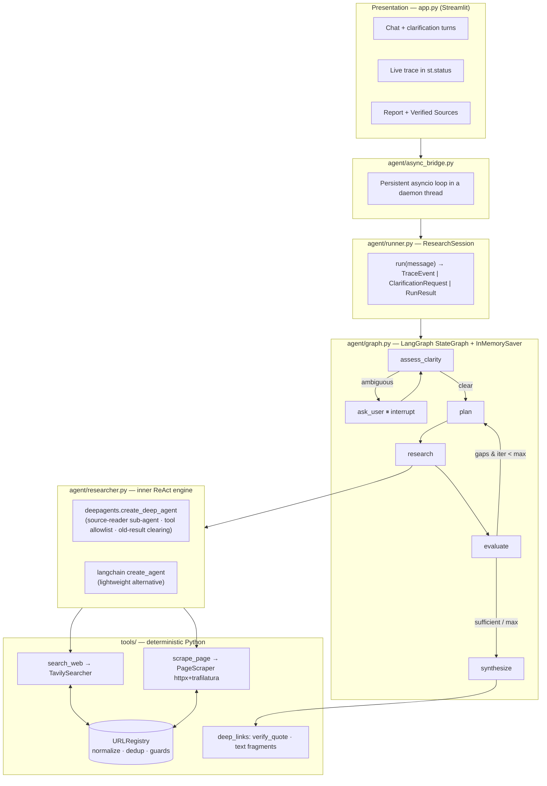
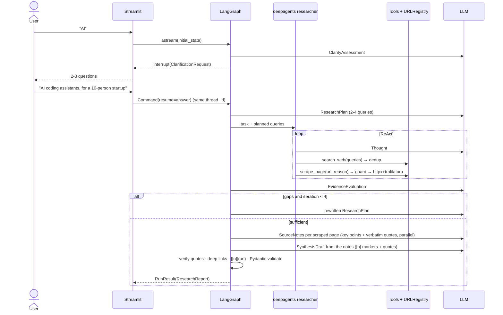
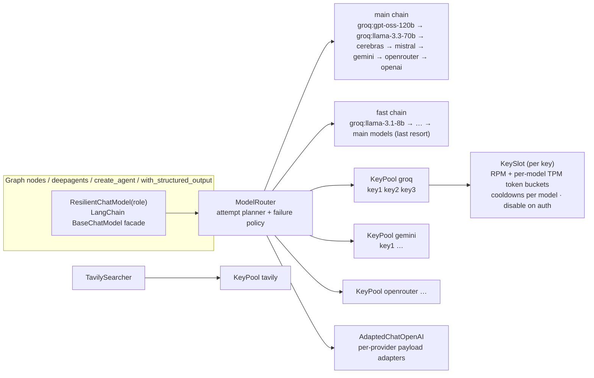

# 🔎 Deep Research ReAct Agent

An **asynchronous, production-grade research agent** that turns a broad question such as
*"Pros and cons of microservices vs. monoliths in 2026"* into a fully formatted, **source-grounded
research report**. Every claim carries a clickable citation, and each citation **deep-links to the
exact supporting passage** on the source page.

Built with **LangGraph** (workflow orchestration and human-in-the-loop), **deepagents** (ReAct research
engine with planning and sub-agents), **Tavily** (search), **httpx + trafilatura** (async full-page
extraction), **Pydantic v2** (strict contracts) and **Streamlit** (chat UI with a live reasoning trace).
A **multi-tier, multi-key, cross-provider LLM router** (Groq → Cerebras → Mistral → Gemini → OpenRouter →
OpenAI) keeps research fast and absorbs rate limits.

```
Clarify ──► Plan ──► Search ──► Selective Scrape ──► Evaluate ──► Synthesize
   ▲  (HITL)   ▲                                       │
   └─ user ─┘  └────────── gaps / conflicts (≤ 4 iterations) ┘
```

---

## Table of contents
1. [What it does](#1-what-it-does)
2. [Architecture](#2-architecture)
3. [The pipeline, stage by stage](#3-the-pipeline-stage-by-stage)
4. [Resilient multi-provider orchestration & multi-key pools](#4-resilient-multi-provider-orchestration--multi-key-pools)
5. [Observability: logs, run records & LangSmith](#5-observability-logs-run-records--langsmith)
6. [Key engineering decisions & trade-offs](#6-key-engineering-decisions--trade-offs)
7. [Project structure](#7-project-structure)
8. [Data contracts (Pydantic v2)](#8-data-contracts-pydantic-v2)
9. [Getting started](#9-getting-started)
10. [Configuration reference](#10-configuration-reference)
11. [Testing](#11-testing)
12. [Walkthrough of a single request](#12-walkthrough-of-a-single-request)
13. [Interview guide: talking points & likely questions](#13-interview-guide-talking-points--likely-questions)
14. [Limitations & roadmap](#14-limitations--roadmap)
15. [Development history](#15-development-history)

---

## 1. What it does

| Capability | How |
|---|---|
| **Ambiguity detection (human-in-the-loop)** | A cheap length heuristic plus an LLM `ClarityAssessment`. If the prompt is vague, the graph **pauses** with LangGraph `interrupt()` and asks 2-3 targeted questions. Your chat reply **resumes the same thread**. |
| **Query decomposition** | Turns the question into 2-4 non-overlapping search queries. On later iterations it **rewrites** queries to close identified gaps, and code filters out any query that already ran. |
| **Deduplicated two-tier retrieval** | Tier 1, `search_web`: Tavily discovery with titles, URLs, scores and snippets. Tier 2, `scrape_page`: full-page Markdown via httpx + trafilatura, used **only** when a snippet is relevant but too thin. A session-level `URLRegistry` normalizes URLs (strips `utm_*`, `gclid`, fragments, `www.`, trailing slashes and so on) and drops duplicate URLs *and* duplicate snippets (mirrored content). |
| **ReAct research engine** | A `deepagents` deep agent runs the Thought → Action → Observation loop and can delegate sub-questions to a `source-reader` **sub-agent**. Context stays small: unused harness tools are hidden from the model, and old tool results are cleared once the conversation grows (the data lives in the registry). |
| **Reflection / self-correction** | An evaluator judges coverage, lists gaps and conflicting claims, and proposes follow-up queries. It loops back to the planner up to `MAX_ITERATIONS=4`. |
| **Grounded synthesis** | **Two-step:** the fast models first extract 2–5 key points with verbatim quotes from each scraped page (in parallel); the report is then written from those notes with `[n]` markers. **Code** checks each quote against the retrieved text, builds `#:~:text=` deep links, rewrites markers to `[[n]](url)`, and Pydantic validates the citation contract. |
| **Streamlit UI** | Chat interface, live `st.status("Researching...")` trace (including deduplicated URLs and skipped scrapes), a metrics row, the report, a contradictions panel, and **Verified Sources** cards with deep links, domain badges and exact quotes. You can also download the report as `.md`. |
| **Rate-limit-proof LLM layer** | Multi-tier cross-provider failover with **multi-key pools** (unlimited keys per provider, round-robin), proactive **per-model** RPM/TPM budgets and context limits, Retry-After-aware cooldowns, error-aware blame (key vs model vs provider), per-provider request adapters and sticky routing. Exposed as one LangChain chat model, so deepagents and structured output use it unchanged. See [§4](#4-resilient-multi-provider-orchestration--multi-key-pools). |
| **Observability** | Rotating JSON-lines app log, per-attempt LLM telemetry, one record file per run plus a cross-run index with quality and cost metrics, and opt-in **LangSmith** tracing (run tree, threads, evaluation feedback). See [§5](#5-observability-logs-run-records--langsmith). |
| **Evaluation harness** | 25-question golden dataset with 115 nuggets, LLM-judged nugget recall and citation precision, frozen-evidence replay for fair A/B tests, bootstrap confidence intervals and an automated ship rule. See [`evals/`](evals/README.md). |
| **Provider-agnostic** | Any OpenAI-compatible endpoint (Groq, Cerebras, Mistral, Gemini, OpenRouter, OpenAI, vLLM, Ollama). Adding a tier means adding a key to `.env`. |

---

## 2. Architecture

### 2.1 Layered view



### 2.2 The two-level design in one sentence
**LangGraph owns *control flow*** (explicit, inspectable, checkpointed, interruptible), while
**deepagents owns *exploration*** (the open-ended ReAct tool loop inside the `research` node). The
tools enforce safety and efficiency in plain Python, so the LLM can't bypass them.

### 2.3 Request lifecycle (sequence)



---

## 3. The pipeline, stage by stage

### ① Ambiguity Gate (`assess_clarity` + `ask_user`)
- **Heuristic:** fewer than `MIN_QUERY_WORDS` (4) words always counts as ambiguous.
- **LLM:** `ClarityAssessment {is_ambiguous, reasoning, missing_constraints, questions[≤3]}`. The prompt
  explicitly tells the model that *broad but well-formed* topics are clear, to avoid over-asking.
- **Pause and resume:** `ask_user` calls `interrupt(ClarificationRequest)`. The Streamlit app sees the
  `__interrupt__` event and shows the questions. The user's next message is sent as
  `Command(resume={"answer": ...})` on the **same `thread_id`**, and the checkpointer restores the
  full state.
- **Multi-turn:** after a reply, control goes back to `assess_clarity`. Up to
  `MAX_CLARIFICATION_ROUNDS` (2) rounds run, then the agent proceeds with stated assumptions.

> **Why two nodes?** LangGraph re-executes an interrupted node from the top on resume. Putting the
> LLM call in `assess_clarity` and *only* `interrupt()` in `ask_user` means resuming never re-pays for,
> or changes, the assessment.

### ② Query Decomposer (`plan`)
- Produces a `ResearchPlan {objective, sub_queries[2-4]}`. A Pydantic validator dedupes the queries and caps them at 4.
- **Query rewriting:** on iteration ≥ 2 the planner receives earlier queries, the coverage summary,
  gaps, conflicts and the evaluator's suggestions, and is told to write *new* angles. Any query the
  registry has already executed is then **filtered out in code**. If nothing new remains, the
  evaluator's follow-ups or a synthesized rewrite are used instead.

### ③ + ④ Search → Selective Scrape (`research`)
The node rebuilds the `URLRegistry` from state, creates the tools bound to this iteration's budget,
and runs the inner ReAct agent:

| Tool | Behaviour enforced *in code* |
|---|---|
| `search_web(queries: list[str])` | Runs queries **concurrently** (`asyncio.gather`). Skips queries already run. Normalizes every URL, drops duplicate URLs and duplicate snippets, and emits `dedup` trace events. Returns compact (200-char) snippets with relevance scores. |
| `scrape_page(url, reason)` | **Guard rules:** (a) the URL must have been returned by `search_web` (blocks hallucinated URLs); (b) it must not be already scraped or in flight; (c) its relevance score must be ≥ `SCRAPE_RELEVANCE_THRESHOLD`; (d) the per-iteration budget must not be exhausted. The required `reason` argument makes the model justify *why the snippet lacks detail*. A refusal returns `SKIPPED: <reason>` and emits a `skip` event. A successful scrape returns only a 1.2k-char preview to keep the ReAct context small, while the full text (≤ 12k chars) is stored for the evaluator and synthesizer. |

**Scraper internals** (`tools/scraper.py`): a shared `httpx.AsyncClient` with timeouts, redirects,
connection limits and a semaphore. It streams the body with a size cap, rejects non-HTML content
types, and retries transient errors (429/5xx/transport) with backoff. `trafilatura.extract(...,
output_format="markdown")` runs in `asyncio.to_thread` because it's CPU-bound, with a
precision → recall fallback. **All failures come back as `ScrapedPage(ok=False, error=...)`, never as exceptions.**

**Keeping the ReAct context small** (`agent/researcher.py`, applied to both engines and the sub-agent):
- `ToolAllowlistMiddleware` exposes only `search_web`, `scrape_page`, `task` and `write_todos`.
  deepagents' virtual-filesystem tools (`ls`, `read_file`, `grep`, …) are never used here, and hiding
  them cuts the first `deep` request from ≈3.3k to ≈1.2k tokens.
- LangChain's `ContextEditingMiddleware` + `ClearToolUsesEdit` replace older tool results with a
  placeholder once the conversation passes ~3.5k tokens, keeping the 2 most recent verbatim. Nothing
  is lost: every result is already stored in the `URLRegistry`, which is what the evaluator and
  synthesizer read.

**Resilience:** if the agent raises (rate limit, malformed tool call) or finishes without searching,
the node runs a **deterministic fallback**: it searches every planned query, then scrapes the top-K
unread URLs, using the *same guarded tools*.

### ⑤ Evidence Evaluator (`evaluate`)
`EvidenceEvaluation {is_sufficient, coverage_summary, gaps, conflicting_claims, follow_up_queries,
confidence}` is computed over a size-bounded, numbered evidence digest. The router loops back to
`plan` while evidence is insufficient **and** `iteration < MAX_ITERATIONS`. Conflicts are carried
forward into the final report.

### ⑥ Grounded Synthesizer (`synthesize` + `agent/citations.py`)
1. **Two-step synthesis.**
   - *Step 1, extract:* for each scraped page, the fast chain returns `SourceNotes`: 2–5 key points,
     each with a verbatim quote. It reads up to 6k chars per page, runs at most 4 at a time, and the
     router spreads the calls across keys. Irrelevant pages are dropped; if extraction fails, a
     1.5k-char raw excerpt is used instead. Snippet-only sources pass through unchanged.
   - *Step 2, write:* the main chain receives the *numbered* notes (≈2.5–3k tokens of evidence
     instead of ≈7.5k of raw excerpts) and returns a `SynthesisDraft`: a Markdown answer with `[n]`
     markers, a list of `{source_id, verbatim supporting_quote}`, confidence and contradictions.
     **It never writes URLs.**
2. Deterministic post-processing:
   - normalizes `[1, 2]` → `[1][2]` and strips any links or "Sources" section the model added anyway;
   - **drops hallucinated ids** (e.g. `[99]`) and renumbers sources 1..k by first appearance;
   - **verifies each quote** against the retrieved text (normalized substring match, otherwise a
     `difflib` best-sentence match ≥ 0.72). A verified quote gets a **Scroll-to-Text-Fragment** deep
     link, `url#:~:text=<first 4 words>,<last 4 words>`, percent-encoded with `-`, `,` and `&` escaped
     per the spec. An unverified source falls back to its real search snippet and a plain URL, and the
     UI flags it, so text that isn't from the source is never shown as a quote;
   - rewrites markers to `[[n]](deep_link_url)`.
3. **`ResearchReport` validators** re-check everything: unique ids, no bare `[n]` left, every link
   resolves to a known source and its URL, `confidence_score ∈ [0, 1]`, and each deep link extends its
   source URL.
4. **Calibrated confidence** = `0.5 × writer self-assessment + 0.3 × evaluator confidence + 0.2 ×
   fraction of verified quotes`, capped at 0.2 when there are no sources.

---

## 4. Resilient multi-provider orchestration & multi-key pools

A deep-research run makes **dozens of LLM calls**: control steps, the ReAct loop and parallel
sub-agents. On free and low tiers that hits rate limits within minutes. Groq's free TPM cap per
model, for example, is smaller than one deepagents prompt. The `agent/resilience/` package makes
rate limits a routing problem rather than a failure. It extends the pattern from my
[RAG-PROJECT](https://github.com/YashMittal1503/RAG-PROJECT) (`ProviderKeyPool` + tiered failover)
for a tool-calling agent.

### 4.1 Components



| Module | Responsibility |
|---|---|
| `providers.py` | Registry of OpenAI-compatible providers (base URL, default fast/main models, default RPM, **per-model TPM** and **context limits**), tier order, `provider:model` chain and limit parsing, key discovery from `.env` |
| `key_pool.py` | `KeyPool` / `KeySlot`: round-robin rotation, **proactive RPM/TPM token buckets** per key and model, Retry-After-aware cooldowns with exponential backoff, auth disable, health snapshot, key masking |
| `errors.py` | Maps any SDK exception (openai, httpx, Tavily) to an `ErrorKind`, extracts Retry-After from headers (`retry-after`, `retry-after-ms`, Groq `x-ratelimit-reset-*`) or messages ("try again in 7.66s"), and pulls the provider's own error message out of the response body for the trace |
| `adapters.py` | Makes one conversation portable across providers: Mistral gets deterministic 9-char tool-call ids, Gemini gets a placeholder `thought_signature` on historical tool calls, Mistral, Gemini and custom endpoints get `max_tokens` instead of `max_completion_tokens` |
| `router.py` | `ModelRouter` (attempt planning, failure policy, sticky routing, stats, events) and `ResilientChatModel`, which implements `bind_tools` and sends an explicit `max_tokens` per role, so deepagents, `create_agent` and `with_structured_output` work unchanged |

### 4.2 How a call is routed

1. **Estimate the request:** prompt tokens (approx.) + tool schemas + the call's explicit
   `max_tokens` (fast 1,024 · main 2,048 · synthesis 4,096). This matches how providers such as Groq
   count a request: prompt plus requested completion.
2. **Skip what can never fit:** a target whose context limit (e.g. Cerebras free tier ≈8k) or
   per-model TPM capacity is smaller than the request is skipped without a call.
3. **Ready pass (never waits):** walk the chain in tier order, starting with the target that last
   succeeded in this graph-node run (**sticky routing**, so a conversation rarely mixes providers).
   For each model, try its keys round-robin and take the first whose budgets and cooldowns allow
   sending now.
4. **Adapt and send:** the provider's payload adapter rewrites the request (tool-call ids, Gemini
   signatures, `max_tokens`), and the call goes out with SDK retries disabled (`max_retries=0`), so no
   hidden 1-2-4 s backoff sleeps happen inside the SDK. The router fails over in milliseconds instead.
5. **On failure, blame the right thing:**

   | Error | Action |
   |---|---|
   | 429 rate limit | cool **this key for this model** (Retry-After or 20 s → 40 s → … ≤ 300 s), next key |
   | 402 / quota / Tavily 432-433 | park the key for all models (1 h) |
   | 401/403 invalid key | disable the key |
   | 413 / context too large | skip the **model** (key untouched), try a higher-limit one |
   | 404 / decommissioned | remember the model as dead for 15 min |
   | invalid tool call | retry on a different model |
   | 5xx / timeout | short cooldown, fail over to the next provider |
   | our own bug | re-raise immediately |
6. **Patience pass:** only if nothing anywhere is ready, wait for the soonest key/model (bounded by
   `LLM_MAX_WAIT_SECONDS`).
7. **Observe:** every rotation is streamed into the UI trace as a 🔀 event, including the provider's
   own error message (via a `ContextVar` listener inherited by sub-agent tasks), counted in the report's *LLM failovers* metric, and shown
   per key in the sidebar's **Provider health** panel.

### 4.3 Why this keeps research fast
- **Avoid instead of absorb:** proactive budgets mean most 429s are never triggered. Traffic moves to
  the next key or tier *before* the limit.
- **Round-robin across keys** spreads parallel sub-agent calls, so N keys ≈ N× throughput.
- **Per-model limits and cooldowns:** Groq and Gemini enforce limits per model, so budgets and
  cooldowns are per model too. A 9.5k-token call that's too big for `gpt-oss-120b` (8k TPM) goes to
  `llama-3.3-70b` (12k TPM) on the same Groq keys instead of leaving Groq entirely.
- **Portable conversations:** payload adapters let Mistral and Gemini continue a conversation that
  started on another provider. Before adapters, they rejected it (verified live for Gemini).
- **Fast chain for control steps:** clarify, plan and evaluate run on small, fast models and keep the big
  models' budgets for research and synthesis.
- **Process-wide state:** the router and pools are Streamlit `cache_resource` singletons, so cooldowns
  learned in one request protect the next.
- **Stale models degrade gracefully:** a decommissioned default model costs one failed call, then
  it's skipped.

---

## 5. Observability: logs, run records & LangSmith

Three layers, from always-on local files to hosted tracing. They share **one `run_id` per research
run**, so a line in the app log, a run file and a LangSmith trace can be matched exactly.

| Layer | Where | What you get |
|---|---|---|
| **App log** | `logs/app.jsonl` (rotating, 5 MB × 5) | Structured JSON lines from every module, tagged with `run_id` / `thread_id`: router failovers, key cooldowns, scrape failures, run start/finish |
| **LLM call telemetry** | `llm.calls` logger + run files | One record per **router attempt**: role, provider, model, masked key, outcome (`ok` or error kind), latency, estimated vs actual input/output tokens |
| **Run records** | `logs/runs/<date>/<run_id>.jsonl` + `logs/runs/index.jsonl` | Per run: query, engine, chains, every trace event, clarifications, the full report and all LLM calls. The index has one summary line per run with quality and cost metrics |
| **LangSmith** (opt-in) | smith.langchain.com, project `deep-research-agent` | Full run tree, threads, per-attempt child runs, and evaluation feedback scores |

### 5.1 The run index, for evaluation
Each completed run appends a line like this (abridged, illustrative values):
```json
{"run_id": "3f2c…", "thread_id": "9cc0…", "status": "completed", "duration_s": 74.2,
 "confidence": 0.78, "cited_sources": 9, "verified_ratio": 0.89, "contradictions": 2,
 "iterations": 2, "queries_run": 7, "pages_read": 6,
 "llm_calls": 23, "failed_attempts": 3, "input_tokens": 61234, "output_tokens": 9876,
 "failures_by_kind": {"rate_limit": 2, "context_too_large": 1},
 "by_model": {"groq:llama-3.3-70b-versatile": {"calls": 14, "ok": 13, "failed": 1, …}, …}}
```
It loads straight into pandas (`pd.read_json("logs/runs/index.jsonl", lines=True)`) to compare
quality against cost across runs and configurations. That's the raw material for the evaluation
work in [#7](https://github.com/YashMittal1503/ReAct-Search-Agent/issues/7).

### 5.2 LangSmith tracing
Set `LANGSMITH_API_KEY` in `.env`; tracing turns on automatically, with no code changes. Each run produces:
- a root run **`deep-research`** whose id equals the local `run_id`, tagged `engine:<deep|react>` (plus
  `clarification-reply` on resumed turns), with `thread_id` metadata so LangSmith **Threads** group a
  whole conversation;
- every graph node → the deep agent → sub-agents → tool calls, nested automatically;
- one child run per **router attempt**, named like `groq:llama-3.3-70b-versatile` and carrying provider,
  model, masked key, role and attempt metadata. A rate-limited attempt shows as an errored run right
  next to the one that succeeded;
- **feedback scores** on the root run after it completes (`confidence`, `verified_ratio`,
  `cited_sources`, `iterations`, `failover_events`, `llm_calls`, `failed_attempts`, `total_tokens`,
  `duration_s`), which can be filtered and charted across runs;
- a **"🔎 View full trace in LangSmith"** button under each report.

Everything LangSmith-related is best-effort and time-bounded: without a key there are no network
calls, and a LangSmith outage never affects a research run.

### 5.3 In the UI
- **📊 Run metrics** (per report): LLM calls, failed attempts, input/output tokens, LLM time, a
  per-model table, failures by kind, and the run log path.
- **Sidebar → Observability:** LangSmith status and log locations.

---

### 5.4 Experiment: post-retrieval RAG (`experiment/rag` branch, [#19](https://github.com/YashMittal1503/ReAct-Search-Agent/issues/19))
`SYNTHESIS_MODE=rag` replaces per-page LLM key-point extraction with **retrieval**:
1. Chunk scraped pages (`tools/rag/chunker.py`): paragraph-packed, heading-aware chunks (~900 chars)
   with sentence overlap.
2. Rank chunks for **each researched facet** (the question plus every search query the agent ran)
   using **BM25 + local `bge-small-en-v1.5` embeddings** (fastembed/ONNX, CPU, no API), fused with
   Reciprocal Rank Fusion. If the embedding model is unavailable, it falls back to BM25.
3. Select under a 12k-character budget: the best chunk of **every** source first (so no source or
   minority view is dropped), then the top-k chunks per facet, then neighbouring chunks for context.
4. The synthesizer gets the passages in document order, with "[…]" marking gaps. Citations are
   still verified against the full page text.

Compared with `two_step`, this removes one LLM call per scraped page. Whether quality holds is
decided by the harness (`replay --variant rag` vs `baseline`, then `evals.compare`). Ablations:
`rag_bm25`, `rag_tight`. Merged to `main` only on a **SHIP** verdict.

---

## 6. Key engineering decisions & trade-offs

| Decision | Why | Trade-off |
|---|---|---|
| **LangGraph outer graph + deepagents inner engine** | The outer workflow needs guarantees (iteration cap, HITL, checkpointing, explicit routing) that a free-running agent can't give. Searching and reading benefit from an autonomous loop with planning and sub-agents. | Two layers to understand, but each does what it's best at. |
| **Engine is a config flag (`deep` / `react`)** | deepagents adds a large system prompt and extra tools. Small or rate-limited models (Groq free tier) run better on `create_agent`. Both expose the same `{"messages"}` interface. | `react` gives up sub-agent delegation and todo planning. |
| **The LLM never writes URLs** | Removes the biggest hallucination vector in cited reports. Links come from the registry, so every citation points at a page that was actually retrieved. | Needs a post-processing layer (`citations.py`). |
| **Guards live in tools, not prompts** | Prompts are suggestions and code is law. Dedup, scrape budget, relevance threshold and "discovered URLs only" can't be talked around. | Thresholds need tuning per search provider. |
| **`URLRegistry` stored in graph state** (snapshot/restore) | It's checkpointed with the thread, survives interrupts, is isolated per session, and needs no global mutable store. | Page text is serialized into the checkpoint; fine in memory, but use a blob store at scale. |
| **Race-free dedup without locks** | All registry mutations are synchronous. A URL is *claimed* (`in_flight`) before the scrape `await`s, so concurrent tool calls can't double-fetch. | Relies on single-threaded asyncio semantics, which is documented in the code. |
| **Two-tier retrieval** | Snippets are cheap and often enough, while full pages are expensive in latency and tokens. Scraping only when needed cuts cost and context bloat. | The model can occasionally skip a page that would have helped; the evaluator loop mitigates this. |
| **`interrupt()` isolated in its own node** | Resume re-runs the node, so keeping it LLM-free avoids duplicate cost and non-determinism. | One extra node. |
| **Persistent background event loop for Streamlit** | `asyncio.run()` per rerun breaks loop-bound clients ("Event loop is closed"). One daemon-thread loop plus a queue streams events to the script thread live. | Slightly more plumbing (`async_bridge.py`). |
| **Dependency injection (`AgentDeps`)** | Every external dependency (LLM, structured-output call, searcher, scraper, agent factory, clock) can be swapped, so the full graph is tested with fakes and no network. | A bit of indirection. |
| **Structured output with self-correction** | Open-weight models sometimes emit invalid tool arguments. `structured_call` feeds the validation error back once before failing, and each node has a graceful fallback. | One extra LLM call in the failure case. |
| **Router as a `BaseChatModel`, not `with_fallbacks()`** | LangChain's `RunnableWithFallbacks` has no `bind_tools` (so deepagents can't use it), no key pools and no cooldown memory. A custom chat model makes failover invisible to every caller. | Owns its own retry/failover logic, which is fully unit-tested. |
| **Proactive budgets + reactive cooldowns** | Budgets prevent most 429s, and cooldowns handle the rest using the provider's own Retry-After. | Budgets are estimates (chars/4 token counting); defaults are conservative free-tier values. |
| **Hide unused tools and clear old tool results** | The ReAct history resent every earlier search result, and deepagents' filesystem tools added ~2.1k tokens to every call. Both are fixed with middleware rather than by forking the harness. | Old observations become a placeholder; the agent relies on its notes and the latest results. |
| **Two-step synthesis** | Distilling each page into quoted key points shrinks the synthesis prompt ~3× and feeds verbatim quotes into citation verification. | An extra (parallel, fast-model) call per scraped page; extraction could miss a fact, so failures fall back to raw text. Quality is to be measured in [#7](https://github.com/YashMittal1503/ReAct-Search-Agent/issues/7). |
| **Per-provider payload adapters** | "OpenAI-compatible" APIs disagree on tool-call ids, thought signatures and token-limit field names, which broke mid-conversation failover. | A placeholder Gemini signature may slightly reduce its reasoning on transferred turns, which is preferable to a hard 400. |
| **Error classification decides blame** | Punishing a key for a 413 or a dead model wastes healthy capacity. Classification picks key-, model- or provider-level action. | Message heuristics must track provider wording; all mapped cases are covered by tests. |

---

## 7. Project structure

```
.
├── app.py                     # Streamlit chat UI (HITL, live trace, report, Verified Sources)
├── agent/
│   ├── config.py              # Settings (pydantic-settings, .env)
│   ├── llm.py                 # Router-backed chat models + structured_call (self-correcting)
│   ├── resilience/            # Multi-tier, multi-key, cross-provider orchestration
│   │   ├── providers.py       #   provider registry, tier order, model chains, key discovery
│   │   ├── key_pool.py        #   KeyPool/KeySlot: round-robin, RPM + per-model TPM buckets, cooldowns
│   │   ├── errors.py          #   ErrorKind classification, Retry-After + error-detail parsing
│   │   ├── adapters.py        #   per-provider payload adapters (Mistral ids, Gemini signatures)
│   │   └── router.py          #   ModelRouter (+ sticky routing) + ResilientChatModel facade
│   ├── prompts.py             # All system prompts
│   ├── state.py               # ResearchState (TypedDict + reducers), checkpoint-friendly
│   ├── nodes.py               # assess_clarity · ask_user · plan · research · evaluate · synthesize + routers
│   ├── researcher.py          # deepagents / create_agent factory + context-size middleware
│   ├── observability/         # logging_setup · telemetry (LLM calls) · run_log (run files) · tracing (LangSmith)
│   ├── citations.py           # Draft → grounded ResearchReport (quote verification, deep links, linking)
│   ├── graph.py               # StateGraph wiring + checkpointer
│   ├── runner.py              # ResearchSession async API + CLI
│   └── async_bridge.py        # Persistent event loop for Streamlit
├── tools/
│   ├── url_registry.py        # normalize_url · URLRegistry (dedup, scrape guards, snapshot)
│   ├── search.py              # TavilySearcher (async, concurrent, multi-key rotation)
│   ├── scraper.py             # PageScraper (httpx streaming + trafilatura Markdown)
│   ├── deep_links.py          # verify_quote · build_text_fragment (#:~:text=)
│   └── langchain_tools.py     # search_web / scrape_page LangChain tools with guards + trace events
├── schemas/
│   ├── clarification.py       # ClarityAssessment, ClarificationRequest
│   ├── planning.py            # ResearchPlan, SubQuery
│   ├── evidence.py            # SearchResult, ScrapedPage, Evidence, EvidenceEvaluation, SourceNotes
│   ├── report.py              # SynthesisDraft, Source, ResearchReport (strict validators)
│   └── events.py              # TraceEvent (thought/action/observation/dedup/skip/error/status)
├── evals/                     # golden dataset, judge, metrics, snapshot/replay/e2e runner, compare
├── tests/                     # 104 tests: registry, deep links, scraper, schema, graph flow, key pools,
│                              #   router, adapters, research-context middleware, observability, tracing
├── .env.example · requirements.txt · pyproject.toml · .streamlit/config.toml
```

---

## 8. Data contracts (Pydantic v2)

```python
class Source(BaseModel):
    id: int
    title: str
    url: str                      # normalized, http(s) only
    deep_link_url: str            # url + "#:~:text=start,end" when the quote is verified
    supporting_quote: str         # verbatim passage from the source
    quote_verified: bool
    domain: str                   # computed field, for the UI badge

class ResearchReport(BaseModel):
    answer: str                   # Markdown; every citation is "[[n]](url)"
    confidence_score: float       # 0.0 – 1.0
    contradictions_noted: list[str]
    sources: list[Source]
    # model_validator: unique ids · no bare [n] · each [[n]](url) resolves to source n and its url
```

The trace stream uses `TraceEvent {kind, node, message, data, ts}`, where `kind ∈ {status, thought,
action, observation, dedup, skip, error}`.

---

## 9. Getting started

### Prerequisites
- Python **3.11+**
- A **Tavily** API key (free tier available at tavily.com)
- At least one **LLM provider key**: Groq, Cerebras, Mistral, Gemini, OpenRouter, OpenAI, or a local
  OpenAI-compatible server. More keys and more providers give more throughput and resilience.

### Install
```bash
python -m venv .venv
```
```bash
.venv\Scripts\activate          # Windows  (macOS/Linux: source .venv/bin/activate)
```
```bash
pip install -r requirements.txt
```
```bash
cp .env.example .env            # then add provider keys (e.g. GROQ_API_KEY…) and TAVILY_API_KEY
```

### Run the web app
```bash
streamlit run app.py
```
Try the built-in examples. **"AI"** deliberately triggers the Ambiguity Gate.

### Run from the command line
```bash
python -m agent.runner "Pros and cons of microservices vs. monoliths in 2026"
```

### Use as a library
```python
from agent import ResearchSession, RunResult, default_graph

session = ResearchSession(default_graph())
async for item in session.run("State of solid-state EV batteries in 2026"):
    if isinstance(item, RunResult):
        print(item.report.answer)
```

### Model & rate-limit tips
- **Add keys before anything else.** Each extra key adds throughput, and each extra provider adds a
  failover tier. A practical free setup: 2-3 Groq keys + 1 Cerebras + 1 Gemini + 1 OpenRouter.
- **Leave `GROQ_TPM` unset** on the free tier. Built-in per-model limits (gpt-oss-120b 8k,
  llama-3.3-70b 12k, llama-3.1-8b 6k, qwen3-32b 6k) are more precise, and setting `GROQ_TPM`
  applies one value to every Groq model. On paid plans use `GROQ_TPM=0` or `LLM_MODEL_TPM`.
- On a paid Cerebras plan set `CEREBRAS_CONTEXT=0` to lift the free tier's ~8k request cap.
- Default model ids live in `agent/resilience/providers.py`. Override them per role with
  `LLM_CHAIN_MAIN` / `LLM_CHAIN_FAST`. Unknown or decommissioned models are skipped automatically.
- Tool calling matters most for the `main` chain (Llama 3.3 70B, gpt-oss-120b, Gemini Flash and
  GPT-4o-mini all work). Small models (≤ 8B) belong in the `fast` chain.
- If you only have one small-quota key, `RESEARCH_ENGINE=react` sends much smaller prompts.

---

## 10. Configuration reference

| Variable | Default | Purpose |
|---|---|---|
| `<P>_API_KEY`, `<P>_API_KEY_2…`, `<P>_API_KEYS` | — | Keys per provider `P` ∈ `GROQ, CEREBRAS, MISTRAL, GEMINI, OPENROUTER, OPENAI` (unlimited) |
| `<P>_RPM` / `<P>_TPM` | free-tier RPM; built-in per-model TPM | Proactive per-key budgets. `<P>_TPM` applies one value to **all** of the provider's models and overrides the built-in per-model values (`0`/`off` disables) |
| `<P>_CONTEXT` | Cerebras ≈8,192; others none | Max tokens per request; larger requests skip the provider without a call |
| `LLM_MODEL_TPM` / `LLM_MODEL_CONTEXT` | — | Per-model overrides, highest precedence: `provider:model=N,…` |
| `LLM_CHAIN_MAIN` / `LLM_CHAIN_FAST` | auto (tier order) | Explicit `provider:model,…` fallback chains |
| `LLM_MAX_WAIT_SECONDS` | `45` | Longest wait when every key is saturated |
| `LLM_COOLDOWN_BASE_SECONDS` / `_MAX_SECONDS` | `20` / `300` | 429 backoff when there's no Retry-After |
| `LLM_BASE_URL`, `LLM_MODEL`, `LLM_FAST_MODEL`, `LLM_API_KEY(S)` | — | Optional extra "custom" tier (vLLM, Ollama, LM Studio…) |
| `LLM_STRUCTURED_METHOD` | `function_calling` | Structured-output method |
| `TAVILY_API_KEY`, `TAVILY_API_KEY_2…`, `TAVILY_API_KEYS` | — | Search keys (rotated like LLM keys) |
| `TAVILY_RPM` | `100` | Proactive per-key Tavily budget |
| `TAVILY_SEARCH_DEPTH` | `basic` | `basic` / `advanced` / `fast` |
| `SEARCH_RESULTS_PER_QUERY` | `5` | Results per sub-query |
| `RESEARCH_ENGINE` | `deep` | `deep` (deepagents) or `react` (create_agent) |
| `MAX_ITERATIONS` | `4` | Reflection loop cap |
| `MAX_CLARIFICATION_ROUNDS` | `2` | HITL rounds before proceeding with assumptions |
| `MIN_QUERY_WORDS` | `4` | Shorter prompts always trigger clarification |
| `MAX_SCRAPES_PER_ITERATION` | `4` | Scrape budget per iteration |
| `SCRAPE_RELEVANCE_THRESHOLD` | `0.5` | Minimum Tavily score to allow a full scrape |
| `SCRAPE_TIMEOUT_SECONDS` / `SCRAPE_MAX_CHARS` | `15` / `12000` | Fetch timeout and stored text cap |
| `LOG_DIR` / `LOG_LEVEL` / `RUN_LOGS` | `logs` / `INFO` / `true` | App log, run files and run index location; run recording on/off |
| `LANGSMITH_API_KEY` / `LANGSMITH_PROJECT` | — / `deep-research-agent` | Enables LangSmith tracing + feedback (`LANGSMITH_TRACING=false` turns it off) |
| `SYNTHESIS_MODE` | `two_step` | `two_step` (key points, then report), `single_step` (legacy raw excerpts; for evaluation) or `rag` (retrieved passages; **experiment/rag branch**) |
| `RAG_*` | see `.env.example` | Chunk size/overlap, top-k per facet, neighbours, passage budget, embeddings on/off, embedding model |
| `MAX_REPORT_SOURCES` | `12` | Evidence items shown to the synthesizer |

---

## 11. Testing

```bash
python -m pytest -q
```
```bash
python -m pytest -q --doctest-modules tools
```

The suite needs **no API keys and no network**:

| File | Covers |
|---|---|
| `test_url_registry.py` | URL normalization table, duplicate URL and snippet filtering, scrape guards (unknown, low relevance, in flight, already scraped), snapshot round-trip |
| `test_deep_links.py` | Whole-quote vs. range fragments, delimiter escaping, Markdown-insensitive verification, paraphrase snapping, unrelated-quote rejection |
| `test_scraper.py` | trafilatura extraction via `httpx.MockTransport`; PDF, 404 and connection errors returned (not raised); 503 retry; truncation |
| `test_report_schema.py` | Citation contract: bare `[n]`, unknown id, URL mismatch, confidence bounds, duplicate ids, deep-link base check |
| `test_resilience_primitives.py` | Key parsing and masking, token buckets, round-robin, per-model cooldown scope, exponential backoff, Retry-After precedence, auth disable / quota parking, error classification for real `openai` SDK exceptions and Tavily errors, provider discovery and chain building |
| `test_router.py` | Key rotation on 429, cross-provider failover, context-limit skips, per-model TPM routing, `max_tokens` forwarding and budgeting, provider error text in failover events, round-robin distribution, 413 skips the model and not the key, **proactive TPM/RPM routing**, dead-model memory, bounded waiting, exhaustion and fatal re-raise, sync path, `with_structured_output`, a real `create_agent` tool loop and a real **deepagents** run on the router, failover events reaching the LangGraph stream, Tavily key rotation |
| `test_graph_flow.py` | **Full graph:** clarify → `interrupt` → resume → 2 iterations with query rewriting → synthesis with renumbering, hallucinated-id removal, verified deep links and contradictions. Also covers agent-failure fallback with the `max_iterations` cap, real `deepagents`/`create_agent` compilation, and **two-step synthesis** (key points reach the prompt, raw text doesn't, explicit `max_tokens`, extraction-failure fallback, irrelevant pages dropped). |
| `test_observability.py` | JSON logging with run context and extras, idempotent setup, router records every attempt with masked keys, call summaries, run files + index for clarification and completed runs, recorder failures never raise |
| `test_tracing.py` | Tracing off without a key / on with one (env export), root-run config, attempts as named child runs (real callback tree, failed attempt marked as error), node runs parented to the root run, feedback and run URL with a fake client |
| `test_adapters.py` | Mistral id rewrite (9-char, deterministic, paired), Gemini placeholder signature (real ones kept), `max_tokens` rename, router uses the right adapter, sticky routing on/off and fallback when the sticky target is busy |
| `test_research_context.py` | Old tool results cleared and the 2 most recent kept (both engines), deep engine exposes only allow-listed tools, trimmed observations with full text kept in the registry |

---

### Evaluation harness (quality, not just correctness)
Unit tests prove the code does what it says; the harness in [`evals/`](evals/README.md) measures
**how good the answers are**:
- **Golden set:** 25 questions with 115 nuggets, including two ambiguous prompts that test the
  clarification gate.
- **Modes:** `snapshot` freezes retrieved evidence once; `replay --variant X` re-runs only synthesis on
  that evidence (a fair A/B test); `e2e` runs everything.
- **Metrics:** nugget recall, citation precision (both LLM-judged with audit trails), verified-quote
  ratio, gate accuracy, tokens and latency, with 95% bootstrap confidence intervals.
- **`python -m evals.compare A B`** applies the ship rule: quality drop ≤ 2 points and ≥ 20% fewer input
  tokens. Results within noise are reported as **INCONCLUSIVE**.

Variants include `single_step` (the pre-#3 synthesis), so the two-step decision can be re-checked on
real data. Post-retrieval RAG ([#19](https://github.com/YashMittal1503/ReAct-Search-Agent/issues/19)) is developed on the `experiment/rag` branch and
judged with this harness before any merge.

---

## 12. Walkthrough of a single request

*Illustrative example. Exact queries, counts and sources vary by model and by what the web returns.*

**Input:** `"microservices?"`
1. `assess_clarity`: 1 word, below the minimum, so the LLM proposes *"Which architecture are you comparing
   against?"* and *"What team size and domain?"*. The graph pauses at `ask_user`.
2. The user replies *"vs monoliths, backend web apps, team of 8"*. `Command(resume=...)` merges the
   reply into `clarified_query`, and the re-assessment says it's clear.
3. `plan` (iteration 1): `["microservices vs monolith trade-offs 2026", "monolith operational cost small teams", "microservices team size threshold"]`.
4. `research`: the deep agent calls `search_web` with all three queries (15 results, 3 duplicates
   filtered, e.g. the same InfoQ article with `?utm_source=`). It scrapes 3 high-scoring pages whose
   snippets lack numbers. One scrape returns `SKIPPED: low relevance score 0.31`, and one PDF fails
   gracefully.
5. `evaluate`: *insufficient*. The gap is "no data on migration cost", and there's a conflict over
   whether "microservices improve deployment frequency" depends on team size.
6. `plan` (iteration 2): rewritten queries such as `"monolith to microservices migration cost case study"`.
7. `research` → `evaluate`: *sufficient*.
8. `synthesize`: draft with `[1]…[7]`. Quotes are verified and deep links built, then Pydantic validates
   and the report renders, with Verified Sources cards whose titles jump straight to the highlighted passage.

---

## 13. Interview guide: talking points & likely questions

**Elevator pitch:** *"A research agent that treats the LLM as an untrusted reasoning component. The
LLM decides what to search and read and writes the prose. Deterministic code owns deduplication,
budgets, URL integrity and citation linking, and Pydantic validates the final contract. LangGraph gives
me explicit, checkpointed control flow with human-in-the-loop, and deepagents gives me an autonomous
ReAct researcher with planning and sub-agents."*

**Q: Why not just one big agent?**
Because you can't reliably guarantee "ask before searching", "at most 4 iterations" or "always produce
a validated report" with prompts alone. Those are workflow invariants, so they live in a graph. The
open-ended part (which pages to read) is where an agent adds value, so that's the only place it runs.

**Q: How do you prevent hallucinated citations?**
Three layers. (1) The LLM only emits `[n]`, never URLs. (2) Ids that don't exist are dropped, and URLs
come from the registry of pages actually retrieved. (3) Quotes are checked against the source text, and
only verified passages get a highlight deep link. Unverified sources show their real snippet and are
flagged in the UI. Pydantic then enforces the contract.

**Q: How does human-in-the-loop work technically?**
`interrupt()` saves the graph state through the checkpointer and surfaces a payload. The UI renders the
questions. The next user message is sent as `Command(resume=...)` with the same `thread_id`, and LangGraph
re-enters the paused node with the answer as `interrupt()`'s return value.

**Q: How is deduplication made robust?**
Canonical URLs (scheme and host case, `www.`, default ports, tracking params, fragments, trailing
slashes, sorted query), plus snippet fingerprints that catch syndicated copies under different URLs,
plus query dedup so rewrites don't re-run earlier searches. The scrape claim happens before any
`await`, which prevents double-fetches under concurrency.

**Q: How would you scale this to production?**
Swap `InMemorySaver` for `PostgresSaver`/`SqliteSaver`, move page bodies to object storage with
references kept in state, serve the graph behind LangGraph Platform or FastAPI with SSE, add a shared
Redis cache for pages and searches keyed by normalized URL and query, add per-tenant rate limiting, and
add LangSmith tracing and eval datasets for evaluator quality and citation precision.

**Q: How do you evaluate quality?**
Measurable proxies: citation precision (the verified-quote ratio is already computed), source diversity
(unique domains), iterations-to-sufficiency, and scrape efficiency (useful pages ÷ scrapes). Next would
be an LLM-as-judge rubric on a fixed question set, with regression runs in CI.

**Q: What breaks most often?**
Weak tool calling on small models (mitigated by structured-output self-correction, the `react` engine
and the deterministic fallback), paywalled or JS-only pages (trafilatura returns nothing, so the agent
falls back to the snippet), and provider rate limits (handled by the router: see the next question).

**Q: How do you deal with rate limits?**
With a router that treats them as a scheduling problem. Every provider has a pool of keys with
per-model RPM/TPM token buckets, so requests go to a key that has budget *before* a 429 happens.
When a 429 does happen, the key is cooled for exactly the provider's Retry-After, scoped to that model,
and the call moves to the next key, then the next model, then the next provider, in milliseconds,
because SDK retries are off. Errors are classified so a 413 skips the model without punishing the
key, a bad key is disabled, and a dead model is remembered. It's a LangChain `BaseChatModel`, so
deepagents and structured output didn't change at all.

**Q: Why not LangChain's `with_fallbacks()`?**
It returns a `RunnableWithFallbacks`, which has no `bind_tools`, so deepagents and `create_agent`
can't use it. It also has no notion of keys, cooldowns, budgets or shared state across requests.

---

## 14. Limitations & roadmap

**Known limitations**
- Text fragments highlight in Chromium browsers and Safari 16.1+. Firefox opens the page without the highlight.
- JS-rendered pages and PDFs aren't extracted. The agent relies on their snippets.
- Checkpoints are in-memory, so restarting the app clears conversations.
- Confidence is a heuristic blend, not a calibrated probability.
- Router and key-pool state (cooldowns, budgets) lives in process memory. Multiple app replicas would
  each keep their own view; a shared Redis-backed pool is the fix.
- Token budgets use an approximate count (chars/4), so TPM limits are respected approximately, not exactly.
- Built-in per-model TPM and context values are free-tier defaults and may drift as providers change limits.
- The Mistral tool-call-id adapter is unit-tested but not yet verified live (the test account's quota was exhausted).

**Roadmap**
- [ ] Redis-backed key pools so cooldowns and budgets are shared across replicas
- [ ] Learn real limits from `x-ratelimit-remaining-*` response headers to auto-tune RPM/TPM budgets
- [ ] PDF extraction (`pypdf`) and an optional headless-browser fetcher for JS-heavy sites
- [ ] Persistent checkpointer (SQLite/Postgres) and a conversation history sidebar
- [ ] Source credibility scoring (domain allow and deny lists, publication date freshness)
- [ ] Token-level streaming of the final report
- [x] Evaluation harness + golden dataset ([#7](https://github.com/YashMittal1503/ReAct-Search-Agent/issues/7))
- [ ] Post-retrieval RAG experiment on `experiment/rag`, merged only if it passes the ship rule ([#19](https://github.com/YashMittal1503/ReAct-Search-Agent/issues/19))
- [ ] Human review of the golden nuggets (all marked `reviewed: false`)
- [x] Persistent logs, run records and LangSmith tracing ([#15](https://github.com/YashMittal1503/ReAct-Search-Agent/issues/15), [#16](https://github.com/YashMittal1503/ReAct-Search-Agent/issues/16))
- [ ] FastAPI + SSE backend so the agent can serve non-Streamlit clients

---

## 15. Development history

Every change after the initial version went through a GitHub issue (problem, evidence, root cause,
decision) and a PR (what changed, why, tests). The first live run showed calls growing to 8–12k
tokens and a failover cascade that ended on a single OpenRouter key; these fixes came out of
diagnosing it.

| Issue | Problem found | Fix (PR) |
|---|---|---|
| [#1](https://github.com/YashMittal1503/ReAct-Search-Agent/issues/1) | ReAct history resent every tool result (8–12k-token calls) | Clear old tool results with `ContextEditingMiddleware` ([#8](https://github.com/YashMittal1503/ReAct-Search-Agent/pull/8)) |
| [#2](https://github.com/YashMittal1503/ReAct-Search-Agent/issues/2) | Unused deepagents tools cost ~2.1k tokens per call | Tool allowlist + trimmed observations ([#9](https://github.com/YashMittal1503/ReAct-Search-Agent/pull/9)) |
| [#6](https://github.com/YashMittal1503/ReAct-Search-Agent/issues/6) | Failover trace hid the providers' error messages | Error detail in failover events ([#10](https://github.com/YashMittal1503/ReAct-Search-Agent/pull/10)) |
| [#4](https://github.com/YashMittal1503/ReAct-Search-Agent/issues/4) | Gemini 400 (missing thought signature) and Mistral 422 on mixed-provider history | Payload adapters + sticky routing ([#11](https://github.com/YashMittal1503/ReAct-Search-Agent/pull/11)) |
| [#5](https://github.com/YashMittal1503/ReAct-Search-Agent/issues/5) | Limits per provider, not per model; no context-window awareness | Per-model TPM + context limits ([#12](https://github.com/YashMittal1503/ReAct-Search-Agent/pull/12)) |
| [#3](https://github.com/YashMittal1503/ReAct-Search-Agent/issues/3) | ~7.5k-token synthesis prompt; flat 800-token estimate | Two-step synthesis + explicit `max_tokens` ([#13](https://github.com/YashMittal1503/ReAct-Search-Agent/pull/13)) |
| [#15](https://github.com/YashMittal1503/ReAct-Search-Agent/issues/15) | Logs went nowhere; trace events lost on refresh; no per-call LLM telemetry | Persistent logs + run records ([#17](https://github.com/YashMittal1503/ReAct-Search-Agent/pull/17)) |
| [#16](https://github.com/YashMittal1503/ReAct-Search-Agent/issues/16) | No hosted tracing or evaluation signal | LangSmith tracing + feedback (this PR) |
| [#7](https://github.com/YashMittal1503/ReAct-Search-Agent/issues/7) | No way to measure answer quality or compare pipeline changes | Evaluation harness + golden dataset (this PR) |
| [#19](https://github.com/YashMittal1503/ReAct-Search-Agent/issues/19) | Irrelevant text in retrieved pages | *Open:* post-retrieval RAG on the `experiment/rag` branch |
